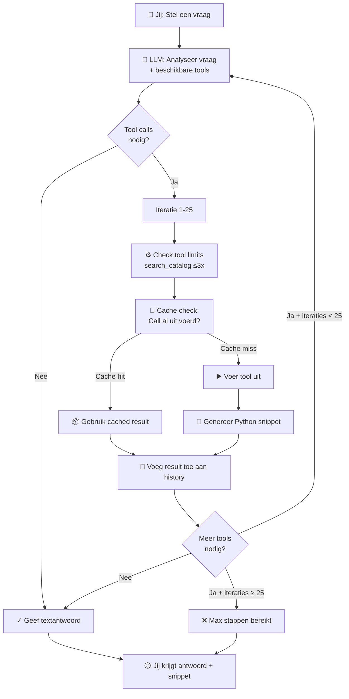

# Tools

De assistent beschikt over de volgende tools. Ze worden automatisch ingezet op basis van je vraag — je hoeft ze niet expliciet aan te roepen.

Bij elke tool-aanroep wordt een reproduceerbaar Python-snippet getoond in de chat, zodat je de analyse lokaal kunt herhalen.

## Hoe tool calling werkt

De assistent volgt een **agentic loop**:

1. **Je stelt een vraag** → Vraag wordt naar het LLM gestuurd met beschikbare tool-schema's
2. **LLM beslist** → Kiest welke tools nodig zijn met parameters
3. **Tools worden uitgevoerd** → Synchroon, in parallel wanneer mogelijk
4. **Resultaten teruggevoerd** → LLM ziet output en beslist of meer tools nodig zijn
5. **Loop** → Stappen 2-4 herhalen totdat LLM alleen tekst antwoordt (geen tool calls meer)

**Beperkingen per turn:**
- Maximaal 25 iteraties (stap 2-4, configureerbaar via `MAX_TOOL_ITERATIONS`)
- `search_catalog` max 3x per vraag (`SEARCH_CATALOG_LIMIT` in `core/config.py`; de prompt noemt hetzelfde getal)
- Tool-resultaten begrensd op 12.000 karakters

**Caching:** Als dezelfde tool met identieke parameters tweemaal wordt aangeroepen, geeft het systeem het eerder gecachde resultaat terug (geen dubbele query).

### Flowchart



---

## Volgorde van de tools

De volgorde staat in de systeemprompt (`prompts/system.md`, "Werkwijze — volg dit altijd"). Daaruit volgen drie
routes; het model slaat een stap over die niet nodig is.

### Vóór de route: verduidelijking

Vier open slots herkent de app zelf, vóór het model de vraag ziet (`agent/scopevraag.py`, #348):
- een telling bij een plaats die in meer dan één instellingsnaam uit het register zit ("Hoeveel studenten heeft
  Utrecht?"): een kaart met de instellingen uit het register en de woonplaats als opties;
- een kort thema zonder maat ("arbeidsmarkt"): een kaart met de catalogusrecords die `search_catalog` bovenaan zet,
  mits elke term raakt;
- instroom in het hoger onderwijs zonder fase ("de instroom van de HvA", #743): een kaart met twee opties. De eerste is
  eerstejaars ho per instelling (DUO, zonder doorstroom naar een master). De tweede is landelijk per hbo en wo, met de
  masters erbij (CBS 85422NED). Dezelfde vraag geeft zo altijd dezelfde eerste stap; de opties zijn
  altijd geldig. Noemt de vraag een instelling, of bepaalt het profiel haar, dan komt er geen kaart;
- een telling van personen zonder instelling, sector of gebied ("Hoeveel studenten?"): een kaart met twee opties,
  landelijk (mbo, hbo en wo samen) of per sector. Een instelling of regio noemt de gebruiker via "Anders formuleren".
  Noemt de vraag een sector, gebied, eigennaam of instelling, of bepaalt het profiel de instelling of sector, dan
  komt er geen kaart.

Een vraag kan tot **drie kaarten** achter elkaar krijgen. Code leest daarvoor de vraag samen met de gekozen opties,
vraagt een slot nooit twee keer (`clarify_slots` in de sessie) en laat het model daarna, tot de limiet, zelf een
`clarify_scope` stellen als er nog een dimensie openstaat waar het antwoord van afhangt. Is een vraag op een andere
manier dubbelzinnig, dan stelt het model zelf die vraag. Na de keuze volgt een van de routes hieronder; na de derde
kaart is `clarify_scope` weg (#75) en gaat het model door met aannames die het noemt.

### Route 1: een vaste maat

**Gebruik:** een telling van studenten, inschrijvingen of eerstejaars per hbo/wo-instelling, mbo-studenten per
instelling of landelijk, ingeschrevenen hbo/wo landelijk, doorstroom vmbo → mbo, of het geslacht van één opleiding.

1. `get_maat` — het model kiest maat, instelling of sector, vorm en schooljaren; de code kiest dataset, bestand en
   codes en geeft één rij per studiejaar.
2. `compute_kpi` — alleen voor een verschil, een procentuele verandering of de grootste daling of stijging.
3. `create_plot` — bij een verloop over meer jaren, met `chart_type="auto"`.

**Voorbeeld:** "Hoeveel studenten had de Hogeschool Utrecht de afgelopen jaren?"
- `get_maat` → `maat="ingeschreven_personen_ho"`, `instelling="Hogeschool Utrecht"`
- `create_plot` → de tijd-as maakt er een lijn van

Past geen maat, of weigert `get_maat` (bijvoorbeeld een onbekende instelling), dan volgt route 2.

### Route 2: zoeken, controleren, laden

1. `search_catalog` — hooguit `SEARCH_CATALOG_LIMIT` (3) keer per vraag; bij een regionale vraag met `geo_niveau`.
2. `dataset_details` — verplicht vóór het laden, voor de 1-3 beste kandidaten.
3. `get_cbs_dimension` — bij CBS voor elke dimensie die in de selectie komt.
4. `get_cbs_data` (met `selectie`), `get_duo_data` (met `resource` als de dataset meer bestanden heeft) of
   `get_rio_data` — geeft een schema, een preview en een `data_key`, geen rijen.
5. `dataset_profiel` — als de korrel van de tabel niet zeker is, vóór een som of telling.
6. `query_data` — filteren en aggregeren (`group_by`, `aggregate`); `compute_kpi` voor een verschil of percentage,
   `run_analysis` alleen voor wat daar niet mee kan.
7. `create_plot` (`chart_type="auto"`) of `create_choropleth_map` voor een kaart per provincie, gemeente of COROP.

**Voorbeeld:** "Instroom in het hbo per provincie, als kaart"
- `search_catalog` → met `geo_niveau="provincie"`
- `dataset_details` → de beste kandidaten
- `get_cbs_dimension` → per dimensie de codes
- `get_cbs_data` → `selectie` met de regio op `"*"` en de andere dimensies op hun totaalcode
- `create_choropleth_map` → `level="provincie"`

### Route 3: twee bronnen naast elkaar

1. Laad elke bron via route 1 of 2.
2. `relatie(data_key, andere_key)` — welke kolommen dezelfde sleutel dragen, hoe de waarden vertalen
   (GM0344 ↔ 344, 2021SJ00 ↔ 2021) en hoe groot de overlap is.
3. Alleen met een gedeelde sleutel: `run_analysis` met `df` en `store_get('<key>')` voor de koppeling. Zonder gedeelde
   sleutel koppelt het model niet en antwoordt het per bron apart.
4. `create_plot` op de `data_key` van het resultaat; één y-as, `color_by` voor groepen.

Arbeidsmarkt-context (`get_uwv_vacatures`, `get_roa_benchmark`) komt als tekst bij een onderwijsantwoord, niet als
eigen grafiek, en gaat nooit over één instelling.

---

## Keuzes die het LLM maakt

Bij elke vraag bepaalt het LLM automatisch:

| Beslissing | Criterium |
|-----------|-----------|
| **search_catalog nodig?** | Vraag noemt geen specifieke dataset |
| **dataset_details nodig?** | Onzeker over beschikbare filters/dimensies |
| **query_data nodig?** | Data moet gefilterd, gegroepeerd of geclusterd |
| **run_analysis nodig?** | Complexe berekeningen, transformaties, joins |
| **Visualisatie nodig?** | Vraag vraagt om grafiek/kaart, OF data is complex |
| **clarify_scope nodig?** | Vraag heeft meerdere geldige interpretaties |

Het LLM springt stappen over als ze niet nodig zijn. Dit heet **"lazy evaluation"** — efficiënter en sneller.

## get_maat

Vaste maat uit een vast recept (#188): het model kiest de maat en de afbakening, de code kiest dataset, bestand,
kolommen en codes (`tools/maten.py`). Elke fout uit de audits die in de keten zoeken → details → bestand → codes
zat (verkeerde instellingscode, T001228 als voltijd, het bestand zonder OPLEIDINGSVORM, personen of inschrijvingen
per sessie anders, verkeerd schooljaar) is zo een beslissing van code.

| Parameter | Type | Beschrijving |
|-----------|------|-------------|
| `maat` | string | `ingeschreven_personen_ho` (p01hoinges), `inschrijvingen_ho` (p03hoinschr), `eerstejaars_ho` (p02ho1ejrs), `deelnemers_ho_landelijk` (CBS 85423NED), `mbo_studenten_instelling` (mbo-studenten-per-instelling), `mbo_studenten_landelijk` (CBS 85354NED), `doorstroom_vmbo_mbo` (CBS 85569NED, landelijk) |
| `instelling` | string | Officiële naam of alias; het register (`data/instellingen.py`) geeft code en sector. Onbekend is een fout, geen gok; bij een landelijke maat ook een fout (#805) |
| `sector` | string | Alleen bij `deelnemers_ho_landelijk`: `hbo` of `wo` |
| `vorm` | string | `alle` (standaard), `voltijd`, `deeltijd`, `duaal` (ho) of `bol`, `bbl` (mbo) |
| `schooljaren` | array | `2024/25` of `2024`; weglaten voor alle beschikbare |
| `opleiding_naar_geslacht` | string | Geslacht van één opleiding (naam of CROHO-code) bij een hbo/wo-instelling, met `ingeschreven_personen_ho`, `eerstejaars_ho` of `inschrijvingen_ho` en zonder vorm (#742) |

Per maat ligt vast: het DUO-bestand (het opleidingsvorm-bestand per sector, #325), de telkolom, de codes van de
vorm (`VT`/`DT`/`DU`, bij CBS `A028666`…), de vaste CBS-totaalcodes (fase, geslacht) en de teldefinitie. De tool
laadt en selecteert met `get_duo_data`/`get_cbs_data` en `query_data`, dus scopegrens, sentinelmaskering, afronding
en KeyMeta gelden gewoon. Het resultaat: `data_key` met één rij per studiejaar, `teldefinitie`, `recept` (wat de
code koos), `periodekolom`/`waardekolom`, en `ontbrekende_schooljaren` als de bron een gevraagd jaar niet heeft.
Bij mbo is `AANTAL` de som van de leerwegkolommen van de vorm, als eigen key. `doorstroom_vmbo_mbo` (#667) is de
som van twee vmbo-posities een jaar eerder (`A041923` + `A041922`) in CBS 85569NED, ook als eigen key; het resultaat
heeft `alternatieve_bron` (DUO "Instromende mbo-studenten") en het antwoord eindigt met een regel uit code over de
bron, de definitie en dat alternatief (zie `docs/domeinregels.md`). `mbo_studenten_landelijk` (#805) is het
landelijke totaal uit CBS 85354NED: `Leerweg` volgt bij vorm `alle` de extranei-standaard, `bol`/`bbl` pinnen
`A041868`/`A025293`; het alternatief is DUO "Mbo-studenten per instelling", met dezelfde regel onder het antwoord. Een key uit `get_maat` komt na een
herstart terug door het recept opnieuw te draaien (`tools/herlaad.py`); de snippet is het recept als script.

**Standaard:** "studenten" = personen (p01); inschrijvingen (p03) alleen op expliciete vraag, met vermelding.

**Geslacht per opleiding** (#742, `tools/geslacht_opleiding.py`). DUO heeft geslacht niet per opleiding: het
geslachtsbestand telt per instelling, vestigingsgemeente, onderdeel, subonderdeel en type ho, het niveaubestand in
dezelfde cellen per opleiding. Met `opleiding_naar_geslacht` legt de code ze naast elkaar. In een jaar is de verdeling
exact als de opleiding de enige is in haar cel, er geen -1 in die cel staat en de totalen van beide bestanden gelijk
zijn; dan krijgt dat jaar rijen per geslacht (aantal en `AANDEEL_PROCENT`). Een ander jaar staat onder
`niet_af_te_leiden` met de reden, zonder getal. Zonder enig exact jaar geeft de tool een vaste melding in plaats van een
`data_key`. De opleiding wordt bij de instelling gezocht op code, dan op de hele naam, dan op een deel ervan; passen er
meer, dan noemt de melding ze met hun code. Het resultaat noemt de gekozen `opleiding` en een vaste `afleiding`.

---

## search_catalog

Doorzoekt de gecombineerde catalogus van CBS, RIO en DUO.

| Parameter | Type | Beschrijving |
|-----------|------|-------------|
| `query` | string | Zoekterm, bijv. `"mbo studenten prognose"` |
| `top_n` | integer | Maximaal aantal resultaten (standaard: 15) |
| `geo_niveau` | string | Filter op geografisch niveau (optioneel) |

**Gebruik:** Als startpunt bij onduidelijke vragen of om te verkennen welke datasets beschikbaar zijn.

### De envelope

Het antwoord is altijd dezelfde JSON-envelope (#358, stap 2), ook bij een fout. Voorheen was het een lijst met treffers,
platte tekst bij een miss en pseudo-records met een `melding`; het model las drie vormen.

```json
{"status":"candidates","catalogus":"9eab4249d9b8","kandidaten":[{"dataset_id":"85423NED","bron":"…","geraakt":["ingeschrevenen","hbo"],…}],
 "meldingen":["…"],"vervolgstap":"Kies de kandidaat die de vraag dekt en bekijk hem met dataset_details voordat je data laadt."}
```

| Veld | Betekenis |
|------|-----------|
| `status` | Wat er gebeurde, zie hieronder |
| `catalogus` | Korte hash van de geladen catalogus (#344): een verschoven top is zo terug te voeren op een andere catalogus |
| `gezocht` | Bij `no_match` en `needs_clarification`: de zoektermen na het schrappen van stopwoorden, zodat een tweede poging ze niet loslaat |
| `melding` | Wat het model moet weten bij een uitkomst zonder kandidaten |
| `meldingen` | Teksten bij kandidaten: een volzin als zoekterm (#351), onbekende geodekking, weggelaten treffers |
| `kandidaten` | Zie hieronder; bij `needs_clarification` alleen `{dataset_id, bron}` |
| `vervolgstap` | Wat het model daarna doet; de begrensde herformulering staat hier |

| `status` | Wanneer | Wat het model doet |
|----------|---------|--------------------|
| `candidates` | Minstens één treffer | Kiest er één tot drie, controleert ze met `dataset_details`, laadt daarna data |
| `no_match` | Niets raakt de vraag (of het geo-niveau) | Zoekt hooguit één keer opnieuw met andere of bredere termen, zonder sector, periode of populatie los te laten; vindt ook dat niets, dan zegt het dat de catalogus geen dataset vindt, niet dat de data niet bestaat |
| `needs_clarification` | Alleen zwakke suggesties (drempel #351) | Laadt er geen, stelt met `clarify_scope` één vraag met deze datasets als opties |
| `out_of_scope` | De zoekvraag gaat over po, so of vo en noemt geen ho of mbo (dezelfde regel als `agent/po_vraag.py`) | Legt uit dat de assistent alleen mbo, hbo en wo behandelt |
| `metadata_unknown` | Met `geo_niveau`: geen dataset heeft het niveau zeker, wel van enkele is de dekking onbekend | Controleert de dekking met `dataset_details` |
| `source_unavailable` | De catalogus (package `onderwijsbronnen`) is niet leesbaar | Zegt dat zoeken nu niet werkt |
| `tool_error` | Een onverwachte fout in de zoekfunctie | Probeert hooguit één keer opnieuw |

Een kandidaat is de compacte hit, plus `dataset_id` (het ID om in `dataset_details` en de datatools te gebruiken) en
`geraakt`: de zoektermen die hij raakt. Raakt een kandidaat maar één van meer termen, dan weegt het model of hij de
rest van de vraag dekt.

Een zoekhit is compact (#358): het dataset-ID, `bron` (de titel), `status`, `leverancier`, `periode`, `onderwijstype`, één
`samenvatting` van hoogstens 200 tekens (anders de beschrijving of het doel), bij CBS `_dimensies`, `_meetwaarden` (de eerste
twaalf), `_geo_niveau`, `_perioden_formaat` en `_periode_waarden`, bij DUO de `zoekkaart`, bij RIO `filters` en `sub_resources`,
en `niet_geschikt_voor` (de eerste drie). Lege velden staan er niet in. De documentatielink, voorbeeldvragen, tags,
`combineerbaar_met`, kolomtoelichting en waardenbereik staan in `dataset_details` (en op de catalogussite), niet in de hit:
met alles erbij woog een RIO-hit 4.800 tekens en ging acht van twaalf zoektermen bij `top_n=15` over de grens van 12.000
tekens die het model van een toolresultaat ziet (`TOOL_RESULT_MAX_CHARS`), zodat het de afkapmelding las en de rest van de
treffers nooit zag. Past het resultaat ook zo niet, dan laat de tool hele kandidaten van achteren weg en zegt hoeveel in `meldingen`, zodat
het model geldige JSON leest; minstens één kandidaat blijft staan.

**Let op:** Deze tool is beperkt tot **3 aanroepen per vraag** (`SEARCH_CATALOG_LIMIT`) om oneindige zoeklussen te voorkomen; de systeemprompt noemt hetzelfde getal.

Elke hit draagt een `status` (#356): `opvraagbaar` (een datatool laadt hem), `via_tool` (alleen met de genoemde eigen
tool, zoals `get_uwv_vacatures`), `alleen_documentatie` (de bron heeft alleen een PDF of changelog) of
`alleen_catalogus` (vindbaar en voor de package leesbaar, maar zonder chat-adapter). Zoekbaar, package-leesbaar en
chat-opvraagbaar zijn zo drie verschillende dingen; `_niet_opvraagbaar` in `tools/catalog.py` is de enige plek die
beslist, de package meldt alleen wat ze kan lezen. De interne bronfilter `source` betekent wat hij zegt: `cbs`,
`rio` (alleen RIO), `duo` (alleen DUO), `riodata` (RIO, DUO, ROA en UWV: wat tot #910 het pakket `riodata` was) of `both`.

De tien vo-bronnen in `VO_CONTEXT` (`tools/scopeprofiel.py`, epic #554, #877) zitten achter een zoekpoort in code
(`_zoekbaar` in `tools/catalog.py`, #557): ze komen alleen in de resultaten als `ho_markers.vo_context_poort` waar is.
Die kijkt naar de vraag van de gebruiker, niet naar de zoekterm die het model meestuurt (#597): `run()` zet de vraag
per beurt (`ho_markers.beurtvraag`), bij een keuze op een verduidelijkingsvraag samen met de vraag die ze afbakent.
Buiten de chat (MCP) beslist de zoekterm. De poort gaat open als de vraag het ho noemt (hbo, wo, ho, hoger onderwijs,
hogeschool, universiteit; havo en vwo niet, want dat is vo, #597), of een vo-niveau samen met het mbo of een
doorstroomwoord ("Hoeveel vmbo-leerlingen stromen door naar het mbo?", "Waar gaan havisten heen na hun diploma?"), of
voortijdig schoolverlaters die terugkeren in het onderwijs (`ho_markers.opent_vo_context`, #877). Po, (v)so en
doorstroom binnen het vo openen niets. Zo'n hit draagt het veld `context` met de waarde
`vo-context voor vervolgonderwijs: leerlingen in het voortgezet onderwijs (ook vavo en vsv), geen mbo- of ho-studenten`;
de bronregel en de maatkaart zeggen "…, vo-context voor vervolgonderwijs". Met een dataset-ID laadt de chat de data
ook zonder zo'n vraag. Zie [Vo-context voor vervolgonderwijs](databronnen.md#vo-context-voor-vervolgonderwijs).

---

## dataset_details

Haalt metagegevens van een specifieke dataset op (kolommen, dimensies, beschrijving).

| Parameter | Type | Beschrijving |
|-----------|------|-------------|
| `dataset_id` | string | Dataset-ID, bijv. `"85423NED"` (CBS) of `"studentprognoses-mbo-v1"` (DUO); met of zonder bron-voorvoegsel (`cbs:`, `duo:`, `rio:`), hoofdletterongevoelig |

**Gebruik:** Verken beschikbare dimensies/filters voordat je data ophaalt.

Voor een CBS-tabel komen de velden uit het contract van de CBS-package (`tools/cbs_meta.py`, #383, #370):
`populatie` (bronpassages), `sectoren` (mbo/hbo/wo in het profiel), `teldefinitie`, `methodiek` (afronding,
additiviteit, definitiebreuken, publicatiestatus), `perioden` (frequentie, eerste en laatste periode, en per
periodecode de titel met de CBS-status zolang die niet definitief is) en `geografie` (niveaus, dekking). Wat het
contract niet vastlegt, staat er niet in. Het contract-ID `cbs:85423NED`, `cbs_85423ned` en `85423NED` wijzen in
`dataset_details`, `get_cbs_data` en `get_cbs_dimension` naar dezelfde tabel (`tools/bron_ids.py::cbs_tabel_id`, het ID-contract van ADR-010: zonder voorvoegsel, in de spelling van de catalogus).
Hetzelfde geldt voor DUO en RIO (#356): `duo:p01hoinges`, `DUO/P01HOINGES` en `rio:erkenningen` wijzen in `dataset_details`,
`get_duo_data`, `get_rio_data` en de scopegrens naar hetzelfde record (`tools/bron_ids.py::bron_id`); de evals en de packages
spellen `<bron>:<id>`. Het detailrecord draagt dezelfde `status` als een zoekhit.

---

## dataset_counts

Geeft het aantal datasets per bron (CBS, DUO, RIO) dat de chat kan opvragen, plus het aantal gearchiveerde CBS-tabellen. Geen parameters. Dezelfde telling voedt de startpagina.

**Gebruik:** bij een vraag naar hoeveel datasets er zijn. Een telling van zoekresultaten is geen catalogustotaal (#168).

De chat telt alleen RIO/DUO-records binnen het profiel mbo/hbo/wo (`tools/scopeprofiel.py`, #355). Een record valt erbinnen als `onderwijstype` alleen MBO, HBO, WO of HO noemt, of als het ID met een reden in `TOEGELATEN` staat. De enige vo-uitzondering zijn de tien bronnen in `VO_CONTEXT`: ze vallen binnen het profiel en tellen mee, maar zoeken toont ze alleen bij een vraag over het ho of over doorstroom uit het vo (zie [`search_catalog`](#search_catalog)). Al het andere valt erbuiten: po/so/vo, gemengde bestanden, records zonder besluit, en wat `onderwijsbronnen` als `buiten_scope` markeert (#375). Zoeken telt ze niet mee; `dataset_details`, `get_duo_data` en `get_rio_data` geven voor zo'n ID `opvraagbaar: false` en `buiten_scope: true` in plaats van data, ook als het ID rechtstreeks uit de vraag komt.

---

## get_cbs_data

Haalt rijen op uit een CBS-dataset via de OData API. Het model stuurt een gesloten
`selectie`; de server compileert daaruit de OData-parameters (#343, ADR-006). Een selectie
waarin een dimensie noch gepind noch bewust uitgesplitst is, wordt geweigerd vóór de
datacall, met de ontbrekende dimensie(s) erbij.

| Parameter | Type | Beschrijving |
|-----------|------|-------------|
| `dataset_id` | string | CBS dataset-ID, bijv. `"85423NED"` |
| `selectie` | object | `dimensies`: per dimensie een code uit `get_cbs_dimension`, een lijst codes of `"*"` (uitsplitsen); `periode`: lijst van schooljaren/periodecodes, `{"van", "tot"}` of `"*"`; `onderwerpen`: optioneel, kolomsleutels; `sector`: optioneel, `mbo`, `hbo` of `wo`, de sector waarvoor het model de tabel bevraagt |

Voorbeeld: `{"dimensies": {"Geslacht": "T001038", "Opleidingsfase": "*"}, "periode": ["2024/25"]}`.
Schooljaarspelling (`2024/25`) wordt in code vertaald naar de CBS-periodecode (`2024SJ00`).
Elke vergelijking in `$filter` gaat als `trim(Dimensie) eq 'code'`, omdat CBS de sleutels van een
dimensie opvult tot één breedte (`4000   ` naast `T001038`) en gestript toont (#531).
De rijlimiet is een beleidsregel van de server, geen modelparameter.

Na de selectiepoort vraagt `tools/cbs_preflight.py` het contract van de CBS-package (`validate_selection`,
live en gecachet) of de tabel de selectie kan leveren (#370): bestaat elke code in haar dimensie, komt de
periode in de tabel voor, en past de code bij de opgegeven `sector` (`hbo` met `Onderwijssoort=A025297`, wo,
is tegenstrijdig). Alleen `unsupported` houdt de datacall tegen; de weigering noemt per controle de reden en
wat wél in de tabel staat. `unknown` (bronuitval, een dimensie die het contract niet kent) laat door.

Een tabel over meer onderwijssoorten (`scopeprofiel.CBS_SECTORFILTER`: de VSV-tabellen `85368NED`/`85367NED`, de
woonregiotabellen `85701NED`/`85702NED`) laadt alleen haar mbo/hbo/wo-rijen, ook als het model iets anders vraagt.
Haar vo- en vavo-rijen komen alleen mee als `ho_markers.vo_deel_poort` waar is (#879): de vraag van de gebruiker
opent de vo-context én noemt zelf een vo-niveau of voortijdig schoolverlaters, zonder po of (v)so. Een hbo-vraag
zonder vo-niveau opent de zoekpoort wel, maar laadt geen vo-rijen. Buiten de chat (MCP) blijven ze dicht. Code
beslist dat, niet het model: `get_cbs_data` kent geen argument ervoor, de lading houdt het vast (`KeyMeta.vo_context`,
een eigen `data_key` en `vo_context` in het herlaadrecept), en het resultaat draagt dan `context` met het etiket van
de vo-context. De bronregel, de Bronnen, de bronregel onder een rapportgrafiek, de kop van een CSV-export en de
snippet zeggen "…, alleen mbo en vo (vo-context voor vervolgonderwijs)"; een lading zonder vo-rijen houdt "…, alleen
mbo", ook als een latere beurt dezelfde tabel met vo-rijen laadt.

De parameter `filters` (ruwe OData, `{"$filter": …}`) bestaat nog voor bewaarde recepten
en het herladen/verversen van oudere gesprekken, maar zit niet meer in de modelinterface.

---

## get_cbs_dimension

Haalt de mogelijke waarden op van een dimensie in een CBS-dataset. Handig om te zien welke filterwaarden beschikbaar zijn.

| Parameter | Type | Beschrijving |
|-----------|------|-------------|
| `dataset_id` | string | CBS dataset-ID |
| `dimension_name` | string | Naam van de dimensie, bijv. `"Geslacht"` |

---

## get_rio_data

Haalt records op uit het RIO-register.

| Parameter | Type | Beschrijving |
|-----------|------|-------------|
| `resource` | string | Resource naam, bijv. `"onderwijslocaties"` |
| `filters` | object | Filterparameters, bijv. `{"type": "AANGEBODENMBOOPLEIDING"}`; `organisatorischeEenheidcode` is de RIO-code van een aanbieder (zoals `114A897`), niet de BRIN-code |

Een register over alle sectoren (`scopeprofiel.SECTORFILTER`) haalt de chat alleen op met `type` op een mbo/ho-waarde.
Een vo- of vavo-type (`SECTORFILTER_VO_CONTEXT`, zoals `AANGEBODENVAVOOPLEIDING`) mag alleen als
`ho_markers.vo_deel_poort` waar is, dezelfde poort als bij de gemengde CBS-tabellen (#880): "Welke vavo-opleidingen
bieden roc's in Utrecht aan?" wel, een mbo-vraag of een aanroep buiten de chat niet. Zo'n pagina draagt `context` en de
bronregel "…, vo-context voor vervolgonderwijs"; het herlaadrecept onthoudt dat (`vo_context`). Po- en (v)so-typen en
de registers zonder typefilter blijven dicht.

Zie [Databronnen → RIO](databronnen.md) voor beschikbare resources.

---

## get_rio_instelling

Overzicht van één onderwijsinstelling uit RIO, in een vaste route in code (#412): zoek het
bevoegd gezag op naam (of via de instelling met die naam), volg de hiërarchische
instellingsrelaties naar de erkende instellingen en van daar naar de vestigingen, geldig op de
peildatum. Het resultaat noemt het bevoegd gezag, per instelling de vestigingscodes, en
`aantallen` (erkenningen = bestuur + instellingen + vestigingen). Lijsten zijn gesorteerd: dezelfde
registertoestand geeft hetzelfde resultaat. Past de naam op meer besturen, dan komen er
`kandidaten` in plaats van aantallen. Een bestuur zonder mbo- of ho-instelling (WEB/WHW) valt
buiten het profiel; po/vo/so-instellingen onder een mbo-bestuur tellen niet mee.

Een BRIN-code (`"25LG"`) zoekt de instelling zelf in plaats van op naam. Is de instelling met die naam of code
opgeheven en ging ze op in een andere (RIO-overgang, #728), dan geeft de tool `opgegaan` (de stappen) en
`fusiemelding`: "… (25LG) is per 1 augustus 2023 opgegaan in Firda (08PG) (volledige overgang)". Zonder actieve
instelling is de status `opgegaan` in plaats van `niet_gevonden`. De zin komt uit code en staat ook in het
Telling-blok onder het antwoord. Relaties en erkenningen worden gelezen met `datumGeldigOp` op de peildatum. Zie
[Databronnen → Fusies](databronnen.md#fusies-rio-overgangen-728).

| Parameter | Type | Beschrijving |
|-----------|------|-------------|
| `naam` | string | Naam van de instelling of het bestuur, bijv. `"ROC Mondriaan"`, of de BRIN-code, bijv. `"25LG"` |

---

## get_inspectieoordeel

Het oordeel van de Onderwijsinspectie over het bestuur (bevoegd gezag) van een mbo-instelling (#749,
`tools/inspectie.py`).
- **Route:** de code zoekt de instelling in het register en haar bestuur in DUO's adressenbestand (`BEVOEGD GEZAG
  NUMMER`). Daarna leest ze het nieuwste peilbestand per bestuur van de Inspectie. Dat vindt ze via de
  schooljaarpagina, omdat de bestandsnaam elke maand wisselt, en ze haalt het één keer per dag op.
- **Resultaat:** het eindoordeel, het onderzoekskader (`kader`), de standaarden met hun naam, de vaststellingsdatum, de
  peildatum, de sectoren van het bestuur en de bron (CC0 1.0).
  - Welke kolommen de standaarden zijn, hangt af van het kader (#874): bij het onderzoekskader 2021 (`BST2021`,
    `BST21_V25`) BKA1-3, bij het kader 2017 (`BST2017`) KA1-3 en FB1-3, met daarnaast het oordeel per kwaliteitsgebied
    (`kwaliteitsgebieden`). Standaarden uit verschillende kaders zijn niet te vergelijken; dat staat in de uitkomst.
  - Een onbekend kader of een nieuwe kolom in het bestand komt als `INSPECTIE_KADER_ONBEKEND` in het log, en een
    bestuur met een onbekend kader krijgt een `noot` in plaats van standaarden.
  - Een `noot` volgt bij een gemengd bestuur, dat ook po, vo of ho heeft. Het oordeel geldt dan voor het hele bestuur.
  - Een `noot` volgt ook als er geen eindoordeel is.
- **Geen oordeel:** voor hbo en wo komt er een vaste melding: daar accrediteert de NVAO de opleidingen. De
  accreditatiedatums per opleiding staan in `get_accreditatie`; de NVAO-oordelen zitten (nog) niet in de app. Een
  vaste melding komt er ook voor een onbekende instelling en voor een bestuur dat niet in het peilbestand staat.
- **Bronregel:** de app zet "Onderwijsinspectie · Oordelen per bevoegd gezag, peildatum …" onder het antwoord, met een
  link naar het bestand.

| Parameter | Type | Beschrijving |
|-----------|------|-------------|
| `instelling` | string | Officiële naam of alias van de mbo-instelling, bijv. `"ROC Midden Nederland"` |

---

## get_inspectieoordeel_vo

De oordelen van de Onderwijsinspectie over de afdelingen van de vo-scholen in één gemeente, als vo-context voor
vervolgonderwijs (#881, `tools/inspectie_vo.py`). Los van `get_inspectieoordeel`, dat alleen over mbo-besturen gaat.
- **Poort:** de tool geeft alleen data als de vraag van de gebruiker de vo-context opent én zelf een vo-niveau noemt,
  zonder po of (v)so (`ho_markers.vo_deel_poort`, dezelfde poort als het vo-deel van CBS en RIO, #879/#880). Code
  beslist dat, niet het model: zijn argumenten openen niets. Anders komt er een vaste weigering (`POORT_DICHT`) en
  laadt de tool geen bestand. Buiten de chat (MCP, evals) is er geen vraag en blijft de poort dicht.
  - Open: "Hoe beoordeelt de inspectie de havo/vwo-afdelingen van de scholen waar onze eerstejaars hbo vandaan komen
    in Utrecht?", "Hoe beoordeelt de inspectie de vmbo-scholen waarvan de leerlingen doorstromen naar het mbo in
    Utrecht?".
  - Dicht: "Wat is het inspectieoordeel van ROC Midden Nederland?" (mbo), "Hoe beoordeelt de inspectie de opleidingen
    van de Hogeschool Utrecht?" (ho zonder vo-niveau; de zoekpoort is daar wel open), "Hoe beoordeelt de inspectie de
    havo-afdelingen in Utrecht?" (een losse vo-vraag), een vraag die po of (v)so noemt.
  - Een vraag over één vo-school ("het Utrechts Stedelijk Gymnasium") krijgt vóór het model het vaste vo-antwoord
    (`agent/vo_school.py`), en de tool weigert ook dan.
- **Altijd in de toolset:** de tool staat er altijd in en weigert zelf, zoals `get_cbs_data` en `get_rio_data` de poort
  zelf lezen. Zo zit de poort op één plek, voor elke ingang (chat, dispatch), en blijft de toollijst gelijk tussen beurten.
- **Route:** de code leest het nieuwste po-so-vo-bestand uit hetzelfde document als het bg-bestand (dezelfde paginaweg,
  `inspectie.haal_ods`), één keer per dag. Het bestand noemt geen plaats of schoolnaam: die komen uit DUO's adressen
  van vestigingen in het vo (`adressen_vo`, vestigingscode = BRIN + vestigingsnummer), ook één keer per dag.
- **Alleen vo:** alleen rijen met `Sector` VO en `Elementtype` ODS (een onderwijssoort), nooit een speciale school
  (`TypeOVT` SPEC). Po- en so-rijen vallen weg, ook als hun vestigingscode bij DUO in de gemeente staat. Een onbekende
  onderwijssoort komt als `INSPECTIE_VO_ONBEKEND` in het log.
- **Resultaat:** per vestiging de naam, de plaats en per afdeling het oordeel met de vaststellingsdatum ("Voldoende
  (09-06-2026)"), een telling per onderwijssoort en oordeel over alle vestigingen, de peildatum, `context` (het etiket
  "vo-context voor vervolgonderwijs") en de bron (CC0 1.0). Geen standaarden: hun kolommen verschillen per
  onderzoekskader.
  - Meer dan 25 vestigingen (Amsterdam heeft er 84 met een vo-afdeling): de eerste 25 op naam, de telling telt alle, en
    een `noot` zegt dat het afgekapt is.
  - Een `noot` volgt bij het vo-onderdeel van een roc of aoc: het oordeel gaat over dat vo-deel, niet over het mbo.
  - Een `noot` zegt altijd dat de bron niet zegt waar studenten vandaan komen.
- **Bronregel:** "Onderwijsinspectie · Oordelen per school (po/so/vo), vo-context voor vervolgonderwijs, peildatum …",
  met een link naar het bestand.

| Parameter | Type | Beschrijving |
|-----------|------|-------------|
| `gemeente` | string | Naam van de gemeente, bijv. `"Utrecht"` of `"Den Haag"`; spelling als `'s-Gravenhage` telt niet |
| `onderwijssoorten` | array | Optioneel: `vmbo-b`, `vmbo-k`, `vmbo-gt`, `havo`, `vwo`, `pro`; weglaten geeft alle |

---

## get_mbo_indicatoren

Jaarresultaat, diplomaresultaat en nieuwe vsv'ers van een mbo-instelling, elk met de waarde van de vergelijkingsgroep,
uit DUO's indicatoren per instelling (#727, `tools/mbo_indicatoren.py`).
- **Route:** de code zoekt de instelling in het register en haar instellingscode (BRIN) in de nieuwste editie. Die
  vindt ze via `indicatoren.jsp`, en ze haalt het bestand één keer per dag op. Alleen de sheets `JR en DR` en `VSV`.
- **Resultaat:** per indicator (`jaarresultaat`, `diplomaresultaat`, `nieuwe_vsv`) per schooljaar de instelling en de
  vergelijkingsgroep in procenten op één decimaal, en `verschil_procentpunt`. Verder de vergelijkingsgroep (ROC of
  BER), de definities en de bron (DUO, editie, peildatum, URL).
  - Het laatste vsv-jaar heeft `voorlopig: true`.
  - Een lege cel of een 0 in het bestand wordt `null` met `uitleg: "geen cijfer"`, zonder verschil.
  - Een `noot` zegt wat voorlopig is, wat null betekent, en of het bestand dezelfde naam ook onder een andere BRIN
    heeft (niet optellen).
- **Geen cijfers:** voor hbo en wo komt er een vaste melding; ook voor een onbekende instelling en voor een instelling
  die niet in het bestand staat. Wijkt het bestand af van de bekende opbouw, dan volgt een foutmelding zonder cijfers.
- **Bronregel:** de app zet "DUO · Indicatoren per instelling (jaardocument mbo), editie …, peildatum …" onder het
  antwoord, met een link naar het bestand.

| Parameter | Type | Beschrijving |
|-----------|------|-------------|
| `instelling` | string | Officiële naam of alias van de mbo-instelling, bijv. `"ROC Midden Nederland"` |

---

## get_bestuursfinancien

De financiële positie van het bestuur (bevoegd gezag) van een mbo-, hbo- of wo-instelling, uit DUO's financiële
verantwoording uit XBRL (#935, besluit op #725; `tools/financien.py`, bron en rekenen in
`onderwijsbronnen.duo.financien`).
- **Route:** de code zoekt de instelling in het register, het bestuur via DUO's adressenbestand (`bestuur_van`) en de
  verslagjaren in de nieuwste editie. Een bestuursnummer (`40597`) of de bestuursnaam uit de verantwoording werkt ook.
  De editie staat een dag in de cache; daarna vraagt de app de bestanden opnieuw met If-Modified-Since
  (`core.actualiteit.Voorwaardelijk`).
- **Resultaat:** per eenheid en verslagjaar de variant (`geconsolideerd` of `enkelvoudig`), solvabiliteit I en II,
  liquiditeit en rentabiliteit (in procent), elk als `bestuur`, `sector` en `verschil`, het totaal van de
  rijksbijdragen in euro en in miljoenen, bij een universiteit met umc de werkplaatsfunctie apart, de
  liquiditeitsgrens die bij de baten hoort en de `signaleringen`. Verder het sectorcijfer (methode, sector, eenheden per
  jaar), de definities, de signaleringswaarden met bron en jaar, vaste `voorbehouden` en de bron.
  - **Sectorcijfer:** gewogen zoals de Inspectie: de som van de teller gedeeld door de som van de noemer over alle
    eenheden die DUO aan de sector toerekent. Geen mediaan.
  - **Signaleringswaarden** (Inspectie, technisch rapport financiële kwaliteit 2024): solvabiliteit II onder 0,30;
    liquiditeit onder 1,50 / 1,00 / 0,75 / 0,50 naar totale baten (onder € 3 mln, tot en met € 12 mln, tot en met
    € 25 mln, daarboven). Rentabiliteit heeft er geen.
  - **Bestuur 40833** heeft drie eenheden (`40833-25LR`, `-25PZ`, `-30RM`): ROC van Amsterdam krijgt alleen 25PZ, het
    bestuur alle drie, nooit een som.
  - **Over meerdere jaren** (#964): per eenheid `ten_opzichte_van_sector`, per kengetal de verslagjaren `onder`,
    `gelijk` en `boven` het sectorcijfer (uit het `verschil`; `zonder_vergelijking` bij een lege waarde), en
    `onder_signaleringswaarde`, per kengetal de jaren met een signalering. Boven of onder, geen beter of slechter. De
    noot staat een uitspraak als "in alle jaren" alleen toe als dit veld dat zegt; een signalering is een berekend
    signaal tegen de drempel van de Inspectie, geen oordeel van de Inspectie, en geen signalering is geen
    "financieel sterk".
  - Een `melding` per eenheid bij een wissel van variant of een reeks die later begint of eerder stopt; een `noot` bij
    `null` (leeg in de bron, geen 0), bij een bestuur dat DUO aan een andere sector toerekent (Aeres Hogeschool: mbo),
    en bij een bestuursfusie binnen de reeks (RIO-overgangen, `fusies.bestuur_in_reeks`).
- **Geen cijfers:** een bestuur dat DUO niet aan mbo, hbo of wo toerekent (po, vo), een onbekende instelling, een
  instelling zonder bestuur in het adressenbestand (27YA). Op playground en productie geeft de tool alleen een melding als
  `LICENTIE_BEVESTIGD` in `tools/beschikbaarheid.py` op False staat (nu True: CC0 van DUO, #956).
- **Bronregel:** "DUO · Financiële verantwoording uit XBRL (variant standaard), editie verslagjaren …, peildatum …,
  versie van …", met een link naar de pagina van DUO.
- **Snippet:** `financien.overzicht(financien.laad(), "<bestuur>")`, dezelfde pakketfunctie als de tool, onafgerond.

| Parameter | Type | Beschrijving |
|-----------|------|-------------|
| `instelling_of_bestuur` | string | Naam, alias of instellingscode uit het register, of het bestuursnummer, bijv. `"ROC Midden Nederland"` of `"40597"` |

---

## get_accreditatie

De accreditatiedatums van één hbo- of wo-opleiding bij één instelling, uit DUO's Overzicht Erkenningen ho (#726 stap A,
`tools/accreditatie.py`).
- **Route:** de code zoekt de instelling in het register en laadt het erkenningenbestand via `get_duo_data`
  (`overzicht-erkenningen-ho`, bestand 0; CC-BY, dagelijks bijgewerkt). De opleiding zoekt ze op CROHO-code (vijf
  cijfers met voorloopnullen: `4181` is `04181`) of op naam, met dezelfde resolutie als geslacht per opleiding
  (`tools/geslacht_opleiding.py`). Passen er meer opleidingen, dan noemt de melding ze met niveau en code.
- **Resultaat:** per datum die DUO registreert de datum en zijn betekenis, uit code:
  - `besluitdatum`: het besluit of de melding van de NVAO; `begindatum`: begin van de geldigheid.
  - `uiterste_indiening_volgende_beoordeling` (`ACCREDITATIE_INLEVERDATUM`): de uiterste indiening van het
    visitatierapport. Nooit een einddatum; ligt hij in het verleden, dan zegt een `noot` dat de accreditatie daarmee
    niet verlopen is.
  - `uiterste_indiening_voorwaarden`, `verlengd_tot` (met de WHW-grond), `intrekking` en `afbouw`, als DUO ze vult.
  - `vervaldatum_nieuwe_opleiding`: alleen met de uitleg dat hij bij de termijn van een nieuwe opleiding hoort.
  - Verder: niveau en vormen, of de erkenning actueel of toekomstig is, `geen_oordeel` (er zit geen NVAO-oordeel in)
    en de bron met peilmoment.
- **Geen datums:** een vaste melding voor een onbekende instelling, een mbo-instelling, een onbekende opleiding, een
  opleiding die alleen nog historisch geregistreerd staat, verschillende datums per vestiging of vorm, en een bestand
  waarin een verplichte kolom ontbreekt.
- **Bronregel:** "DUO · Overzicht Erkenningen ho, versie van …" onder het antwoord, met een link naar de datasetpagina,
  zoals bij elke DUO-dataset.

| Parameter | Type | Beschrijving |
|-----------|------|-------------|
| `instelling` | string | Officiële naam of alias van de hbo- of wo-instelling, bijv. `"Hogeschool Utrecht"` |
| `opleiding` | string | Naam of CROHO-code van de opleiding, bijv. `"34035"` |

---

## get_collegegeld

Het wettelijk collegegeld van één studiejaar, uit artikel 9 van de Regeling financiën hoger onderwijs (BWBR0024005;
#729, `tools/collegegeld.py`).
- **Route:** geen bronaanroep. De bedragen staan in een vaste tabel in de code, per studiejaar met de versie van de
  regeling waarin ze zijn nagelezen en de dag van dat nalezen (zie [Databronnen](databronnen.md)). Het model kiest
  alleen het studiejaar; zonder studiejaar is het het lopende (vanaf 1 september het nieuwe).
- **Resultaat:** precies één bedragenpaar: `voltijd.bedrag_euro` (volledig wettelijk collegegeld) en
  `deeltijd_en_duaal` met `minimum_euro` en `maximum_euro` (gedeeltelijk wettelijk collegegeld; de instelling kiest
  het bedrag ertussen), elk met zijn betekenis en wetsartikel. Verder `geen_open_bron` en de bron.
  - Een `noot` volgt bij een vastgestelde wijziging die nog niet geldt, en bij 2023/2024 (verlaagd collegegeld voor
    eerstejaars, niet in de tabel).
- **Geen bedrag:** voor een studiejaar dat niet in de tabel staat, en voor iets wat geen studiejaar is. Het
  instellingscollegegeld is geen open data: de tool zegt dat in elk antwoord, ook als de vraag erover gaat.
- **Bronregel:** "wetten.nl · Regeling financiën hoger onderwijs (BWBR0024005), artikel 9, versie van …, opgehaald
  op …" onder het antwoord, met een link naar dat artikel in die versie.

| Parameter | Type | Beschrijving |
|-----------|------|-------------|
| `studiejaar` | integer, optioneel | Startjaar van het studiejaar, bijv. `2026` voor 2026/2027 |

---

## get_wo_personeel

Personeel in dienst van een universiteit of van de 14 universiteiten samen, uit het WOPI-bestand van UNL (#936,
`tools/wo_personeel.py`). Alleen met de vlag `ENABLE_WO_PERSONEEL` (alleen op test); zonder vlag staat de tool niet in
de toolset en geeft de dispatch "Onbekende tool".
- **Route:** `onderwijsbronnen.unl` haalt de nieuwste editie op en leest de records van de draaitabellen; één lading
  per 24 uur (`core/actualiteit.py`). De instelling wordt een BRIN-code via het register; een BRIN of de naam uit WOPI
  werkt ook zonder register.
- **Resultaat:** `cijfers` per jaar met `peildatum` en `totaal`, en per uitsplitsing de groepen (`wetenschappelijk_personeel`
  en `obp`; de functiecodes; `vast`, `tijdelijk` en `aandeel_tijdelijk_procent`; `vrouwen` en
  `aandeel_vrouwen_procent`; de leeftijdsklassen). Elk getal is een som over de records, uitgerekend in code. Verder
  `voorbehouden` (peildatum, fte is geen personen, wat niet meetelt, de GEZO-variant, jaarverslagen), `noot` bij een
  breuk in de reeks en `bron` met de vaste bronregel.
- **Geen cijfer:** voor een hogeschool of mbo-instelling (vaste melding: geen open bron), voor de vier wo-instellingen
  buiten UNL, voor een onbekende instelling, voor GEZO vóór 2006, voor vast/tijdelijk vóór 2003, en voor een
  combinatie die het bestand niet heeft (personen per functie, fte per leeftijd, HOOP-gebied, salarisgroep).
- **Snippet:** `unl.load(...)` met de keuze van de app (BRIN, jaren) en dezelfde rekenstappen;
  `tests/test_wo_personeel.py` voert hem uit en vergelijkt de uitkomst met de tool.

| Parameter | Type | Beschrijving |
|-----------|------|-------------|
| `instelling` | string, optioneel | Naam, afkorting of BRIN-code, of `landelijk` (standaard) |
| `jaar` | integer, optioneel | Peiljaar (31 december); standaard het nieuwste |
| `reeks` | boolean, optioneel | Alle beschikbare jaren |
| `uitsplitsing` | enum, optioneel | `geen`, `wp_obp`, `functie`, `vast_tijdelijk`, `geslacht`, `leeftijd` (alleen personen) |
| `eenheid` | enum, optioneel | `fte` (standaard) of `personen` |
| `gezo` | enum, optioneel | `excl` (standaard) of `incl`, nooit gemengd |

---

## get_studiekeuze

Opleidingen van hogescholen en universiteiten uit de Studiekeuzedatabase van het Landelijk Centrum Studiekeuze (#957,
`tools/studiekeuze.py`, rekenen in `onderwijsbronnen.skdb`). Alleen waar `STUDIEKEUZEDATABASE_API_KEY` staat (test en
playground); zonder sleutel staat de tool niet in de toolset en geeft de dispatch "Onbekende tool".
- **Route:** `onderwijsbronnen.skdb` haalt de dagexport op (één ZIP met alle tabellen); één lading per 24 uur
  (`core/actualiteit.py`). De instelling wordt een BRIN-code via de export of het register; een opleiding een
  CROHO-code, een studiecode of een naamfilter. Passen er meer instellingen of studies, dan noemt de melding ze en kiest
  de gebruiker.
- **Weergaven:**
  - `opleidingen`: per opleiding van een instelling en per vorm het NSE-oordeel met `nse_respondenten` en
    `nse_oordeel_landelijk` (dezelfde studie en vorm over alle instellingen, van LCSK), studenten, eerstejaars,
    `doorstroom_jaar2_pct`, `diploma_opleiding_pct`, numerus fixus met capaciteit, wettelijk collegegeld en
    accreditatiedatum; de NSE-thema's alleen bij hooguit drie rijen.
  - `studie`: één landelijke studie per vorm, met het aantal aanbieders en de arbeidsmarkt van de SOI-rubriek.
  - `numerus_fixus`: opleidingen met loting of decentrale selectie, capaciteit per taaltraject en studiejaar.
  - `doorstroom_mbo_hbo` en `doorstroom_bachelor_master`: aantal, aandeel en rang (van LCSK) per vervolgstudie.
- **Resultaat:** `rijen` (hooguit 15; `afgekapt` zegt hoeveel er zijn, de hele tabel staat onder `data_key`),
  `selectie` met de opgeloste aanroep, vaste `voorbehouden` per weergave (NSE-jaar en schaal, onzekerheid onder 30
  respondenten, 1cijferHO-jaar, wat de percentages betekenen, de SOI-rubriek, en bij een sortering op een cijfer dat
  het een rangorde op één cijfer is en geen kwaliteitsoordeel), `koppelen` (BRIN en CROHO naar DUO en RIO) en `bron`
  met de verplichte bronregel van LCSK en het versienummer van de export. Afronden, sorteren en het landelijke oordeel
  doet de code; zie de [verantwoording](databronnen.md#verantwoording-hoe-de-app-selecteert-sorteert-en-afrondt).
- **Geen cijfer:** voor een mbo-instelling of `soort_ho="mbo"` (vaste melding: alleen hbo en wo), voor een instelling
  die niet in de export staat, voor een onbekende studie, voor `opleidingen` zonder instelling, opleiding, plaats of
  numerus fixus, en voor een leeg veld in de bron (geen 0). Zonder sleutel, of als de export een andere vorm heeft, een
  bronfout.
- **Bronregel:** "Studiekeuzedatabase {versie}, Landelijk Centrum Studiekeuze, export van {datum}. Er is gebruik
  gemaakt van de data van Landelijk Centrum Studiekeuze.", met een link naar studiekeuze123.nl/studiekeuzedata.
- **Snippet:** dezelfde functie van `onderwijsbronnen.skdb` met de opgeloste argumenten (`pakketaanroep`), op een
  export die de snippet zelf ophaalt met de eigen sleutel van de gebruiker.

| Parameter | Type | Beschrijving |
|-----------|------|-------------|
| `weergave` | enum, optioneel | `opleidingen` (standaard), `studie`, `numerus_fixus`, `doorstroom_mbo_hbo`, `doorstroom_bachelor_master` |
| `instelling` | string, optioneel | Naam, afkorting of BRIN-code van een hogeschool of universiteit |
| `opleiding` | string, optioneel | Naam (of deel) of CROHO-code; bij `studie` en de doorstroom de naam of studiecode van de landelijke studie |
| `soort_ho` | enum, optioneel | `hbo` of `wo` |
| `graad` | enum, optioneel | `bachelor`, `master` of `associate degree` |
| `vorm` | enum, optioneel | `voltijd`, `deeltijd` of `duaal`; weglaten geeft elke vorm een eigen rij |
| `plaats` | string, optioneel | Plaats van het bezoekadres |
| `mbo_opleiding` | string, optioneel | Bij `doorstroom_mbo_hbo`: naam (of deel) of beroep_id van de mbo-4-opleiding |
| `alleen_numerus_fixus` | boolean, optioneel | Bij `opleidingen`: alleen opleidingen met een numerus fixus |
| `sorteer` | enum, optioneel | Bij `opleidingen`: `naam` (standaard) of aflopend op `oordeel`, `studenten`, `eerstejaars`, `doorstroom_jaar2` |

---

## get_uwv_vacatures

Vacatures van UWV (Open Match) per provincie of gemeente en beroepencluster, als arbeidsmarkt-context bij een
onderwijsvraag (#441, `tools/arbeidsmarkt.py`). Een momentopname: de peildatum komt uit de data, niet uit tekst. Geen
reeks, niet per instelling en zonder opleidingsniveau: UWV legt dat bij vacatures niet vast (#449).

| Parameter | Type | Beschrijving |
|-----------|------|-------------|
| `provincie` | string | Provincienaam, bijv. `"Utrecht"` |
| `gemeente` | string | Optioneel: een gemeente in die provincie, bijv. `"Amersfoort"` |
| `sector` | string | Optioneel: een onderwijssector uit `SECTOR_CLUSTER_MAP` (`data/arbeidsmarkt.py`); de beroepenclusters van die sector tellen mee |

- **Resultaat:** `peildatum`, `totaal_vacatures` en de 15 grootste beroepenclusters (`clusters_getoond` zegt het als
  er meer zijn).
- **Met `sector`** staan drie lagen apart (#460): `uwv_broncijfer` (de ongewogen aantallen van UWV),
  `lokale_classificatie` (welke clusters bij de sector horen: een indeling van deze app, gemaakt met een taalmodel) en
  `gewogen_aandeel` (het sectorgetal; een cluster dat de sector met andere deelt, telt naar rato mee).
- **`data_key`:** de tabel met alle beroepenclusters (`BEROEPENCLUSTER`, `VACATURES`), voor `query_data` en
  `create_plot` (#577).
- Een onbekende provincie, gemeente of sector geeft een melding met de keuzes die wel bestaan.

---

## get_roa_benchmark

Cijfers van ROA (AIS 2030) als arbeidsmarkt-context (#441, `tools/arbeidsmarkt.py`): de schoolverlatersinformatie (SIS
2024: werkloosheid, vast dienstverband, werk buiten de vakrichting; alleen landelijk) en de prognose tot 2030
(landelijk, of per arbeidsmarktregio of provincie). Per opleidingsniveau (mbo 2-4, bachelor, master) of voor één
opleidingssector; niet per instelling.

| Parameter | Type | Beschrijving |
|-----------|------|-------------|
| `sector` | string | Optioneel: een ROA-opleidingssector, bijv. `"Mbo4 - techniek en ict"`; zonder sector alle mbo/hbo/wo-niveaus |
| `regio` | string | Optioneel: een arbeidsmarktregio (bijv. `"Midden-Utrecht"`) of provincie; zonder regio landelijk |

- **Resultaat:** `versie`, `regio`, `schoolverlaters_sis_2024` en `prognose_tot_2030`.
- **Met een regio** ook `regiotype` en per onderdeel `herkomst`. Heeft ROA voor die regio geen cijfers voor een
  onderdeel (de schoolverlaters zijn er alleen landelijk), dan staan daar de landelijke cijfers en zegt `terugval` dat.
- **`data_key`:** de tabel met elk cijfer als rij (`ONDERDEEL`, `REGIO`, `OPLEIDING`, `INDICATOR`, `PERCENTAGE`,
  `AANTAL`, `TYPERING`), voor `query_data` en `create_plot` (#577).
- Een onbekende sector of regio geeft een melding met de keuzes die wel bestaan.

---

## get_duo_data

Laadt een DUO open dataset. Retourneert kolomschema, voorbeeldwaarden en een `data_key` voor vervolgquery's.

| Parameter | Type | Beschrijving |
|-----------|------|-------------|
| `dataset_id` | string | CKAN package-naam, bijv. `"studentprognoses-mbo-v1"` |
| `resource` | integer \| string | Index of naam-substring van het bestand binnen de dataset (standaard: 0) |

!!! note
    De geladen data wordt gecached in de sessie. Roep `get_duo_data` eenmalig aan per dataset en gebruik daarna `query_data` voor gefilterde analyses.

---

## query_data

Filtert, groepeert en aggregeert rijen uit gecachede data. Werkt voor alle databronnen na het ophalen (CBS, RIO, DUO) en voor resultaten van `run_analysis`.

| Parameter | Type | Beschrijving |
|-----------|------|-------------|
| `data_key` | string | Sleutel uit een eerdere tool-aanroep, bijv. `duo:123:0`, `cbs:85423NED` |
| `filters` | object | Kolomfilters met operators: `{"Jaar": {"gte": "2020"}}`, of exact: `{"Leerweg": "Voltijd"}` |
| `columns` | array | Alleen deze kolommen teruggeven |
| `max_rows` | integer | Maximaal aantal rijen (standaard: 500) |
| `group_by` | array | Groeperen op deze kolommen |
| `aggregate` | object | Aggregatiefuncties per kolom, bijv. `{"Aantal": "sum"}` |

---

## dataset_profiel

Het profiel van een geladen tabel (#59, #61): per kolom het type, waar hij op lijkt (`identificatie`, `jaar`,
`schooljaar`, `geocode`, `categorie`, `getal`, `datum`, `tekst`), lege en unieke cellen, bereik en kwartielen
(meetkolommen) of de vaakste waarden, plus `dubbele_rijen_pct` en `kandidaat_sleutels`: de kleinste
kolomcombinaties (tot drie kolommen) die elke rij apart aanwijzen. `korrel` zegt het in woorden.

| Parameter | Type | Beschrijving |
|-----------|------|-------------|
| `data_key` | string | Key uit een laad- of filterstap |

Pure pandas (`tools/profiel.py`), één keer per key berekend en onthouden zolang dezelfde data onder die key
staat; op een afgekapte pagina (`volledig: false`) is het een profiel van de pagina, met waarschuwing.

**Gebruik:** vóór een som of telling over een tabel waarvan het model de korrel niet zeker weet. Een som over
een kolom buiten de korrel telt dubbel (totaalrijen naast onderdelen, meerdere resources in één bestand).

---

## relatie

Relatielaag, stap 1 (#63): wat hangt aan wat tussen CBS, DUO en RIO, uit bestaande kennis en zonder model
(`tools/relaties.py`). Sleutels die bronnen delen (connectoren): instellingscode (BRIN), instellingsnaam,
gemeente, gemeentenaam, provincie, schooljaar, erkende opleiding, opleidingseenheid en aangeboden opleiding,
elk met de kolomnamen waaronder hij voorkomt en een vaste vertaling van de waarden (`GM0344` ↔ `344`,
`PV26` ↔ `Utrecht`, `2021SJ00` ↔ `2021` ↔ `2021/2022`). Een CBS-regiokolom (`RegioS`, `Regiokenmerken`) wordt aan de waarden herkend: de kolom mengt Nederland, landsdelen,
provincies, COROP-gebieden en gemeenten, en geldt als gemeente- of provinciesleutel zodra minstens de helft van de
waarden een `GM`- of `PV`-code is. De overige regio's tellen niet mee in `uniek`, `dekking` en `overlap`.

| Parameter | Type | Beschrijving |
|-----------|------|-------------|
| `data_key` | string | De tabel |
| `andere_key` | string | Optioneel: de tabel om mee te koppelen |

Met één key: per sleutelkolom `koppelt_aan` (register, gebiedsindeling, RIO), `basis` (`handmatig`),
`confidence` (1.0 voor codes met vaste vertaling, 0.8 voor namen) en `dekking` (hoeveel waarden het
instellingsregister, de arbeidsmarktregio-indeling of de provinciecodes kennen). Met twee keys ook
`koppelingen`: de kolomparen met dezelfde sleutel, `type` (one_to_one … many_to_many) en `overlap` van de
genormaliseerde waarden. De tool koppelt niets; de kandidaten staan in het log (`RELATIE kandidaten=…`,
zonder waarden) en de koppeling zelf is een stap in `query_data` of `run_analysis`.

---

## compute_kpi

Berekent één KPI-waarde deterministisch in code over data die al in de store staat, zodat het model zelf geen verschillen of percentages hoeft uit te rekenen. Het model neemt de teruggegeven `value` en `trend` letterlijk over.

| Parameter | Type | Beschrijving |
|-----------|------|-------------|
| `data_key` | string | Sleutel van een `query_data`-resultaat |
| `value_column` | string | Kolom met de numerieke waarden |
| `metric` | string | `last`, `first`, `sum`, `mean`, `min`, `max`, `delta` (laatste − eerste), `pct_change` (procentuele verandering eerste → laatste) of `index` (laatste waarde met eerste = 100), `max_drop` of `max_rise` (grootste daling of stijging tussen twee opeenvolgende rijen; het antwoord noemt in `tussen` welke twee) |
| `sort_column` | string | Optioneel: kolom om op te sorteren voor `last`/`first`/`delta`/`pct_change`/`index`/`max_drop`/`max_rise`, bijv. `STUDIEJAAR`. Zonder deze kolom telt de rijvolgorde. |
| `label` | string | Label van de KPI, bijv. "Voltijd 2025/26" |

---

## run_analysis

Voert pandas/numpy-code uit op eerder opgehaalde data, in een apart, afgeschermd proces.

| Parameter | Type | Beschrijving |
|-----------|------|-------------|
| `code` | string | Python-code (pandas, numpy, plotly express beschikbaar) |
| `data_key` | string | Optionele data_key — het bijbehorende DataFrame is beschikbaar als `df` |

Een AST-controle weigert vooraf onder meer imports, namen met `__` en `exec`, `eval` en `open`. Het script draait daarna in een eigen proces zonder geheimen, netwerk of schrijfrechten, met limieten op CPU-tijd en geheugen en een time-out van 10 seconden. Beschikbare namen: `pd`, `np`, `math`, `px`, `go`, `df` en `store_get`. De afscherming is geen beveiligingsgrens: het model kan willekeurige Python laten uitvoeren binnen de sandbox. Zie [Kwaliteit en veiligheid](kwaliteit-en-veiligheid.md#analyse-sandbox), #62 en #443.

---

## create_plot

Maakt een interactieve Plotly-grafiek.

| Parameter | Type | Beschrijving |
|-----------|------|-------------|
| `chart_type` | string | `"bar"`, `"line"`, `"scatter"`, `"pie"` of `"histogram"` |
| `x` | string | Veldnaam voor de x-as (of labels bij pie) |
| `y` | string | Veldnaam voor de y-as (of waarden bij pie) |
| `title` | string | Titel van de grafiek |
| `data_key` | string | Data_key van eerder opgehaalde data (optioneel, alternatief voor `data`) |
| `data` | array | Lijst van datarijen als objecten (optioneel, alternatief voor `data_key`) |
| `color_by` | string | Veldnaam voor groepering (optioneel) |

De grafiek wordt direct in de chat weergegeven. In een rapport staat onder elke grafiek een bronregel uit code
(`agent/figuurbron.py`, #569): bron en catalogustitel, dataset-ID, bij meer bestanden het bestand, de periode en de
CBS-periodestatus van de getekende rijen, en als link de StatLine-pagina (CBS, #638) of de documentatie-URL uit de
catalogus (andere bronnen). De regel komt uit de
`data_key` van de aanroep; een grafiek uit losse `data` heeft geen herleidbare bron en zegt dat. Rust een rapport
op een afgekapte bron (één pagina, niet de hele bron, #186), dan zet de code per laadkey één vaste regel met bron,
catalogustitel en het aantal opgehaalde rijen vooraan in "Wat dit rapport niet beantwoordt" (`agent/afkapping.py`,
#578).

---

## create_choropleth_map

Maakt een choropleth-kaart van Nederland op provincie-, gemeente- of COROP-niveau.

| Parameter | Type | Beschrijving |
|-----------|------|-------------|
| `data_key` | string | Data_key van eerder opgehaalde data; de kaart leest de rijen zelf uit de store |
| `location_col` | string | Kolomnaam met de locaties: CBS-codes (`PV26`, `GM0344`, `CR17`) of namen |
| `value_col` | string | Kolomnaam met waarden |
| `title` | string | Titel van de kaart |
| `level` | string | `"auto"`, `"provincie"`, `"gemeente"` of `"corop"` (standaard: auto) |

**Locaties (#628).** De kaart tekent tegen CBS-codes. Namen gaan naar dezelfde code (`tools/kaartlocaties.py`),
dus een DUO-kolom als `PROVINCIE INSTELLING` of `GEMEENTE INSTELLING` en elke `query_data`-groepering op een
naamkolom werken: hoofdletters, een voorloopapostrof (`'S-GRAVENHAGE`), het punt in `Hengelo (O.)` en het
gemeentenummer van DUO (`344`) maken niet uit, en `HENGELO` past bij `Hengelo (O.)` zolang er één gebied zo heet
(`BERGEN` is Bergen (L.) of Bergen (NH.) en wordt niet gegokt). Bij `level="auto"` beslist het voorvoegsel van een
code, anders het niveau waar de meeste namen op passen; bij gelijke dekking wint het grootste gebied (de lijst
Utrecht, Groningen is een lijst provincies). Locaties die niet op de kaart staan worden in het antwoord genoemd en
blijven weg uit de figuur. Past geen enkele locatie, of past het gekozen `level` niet, dan is het antwoord een fout
en komt er geen figuur.

---

## clarify_scope

Stelt een verduidelijkingsvraag aan de gebruiker wanneer de oorspronkelijke vraag meerdere interpretaties heeft.

| Parameter | Type | Beschrijving |
|-----------|------|-------------|
| `vraag` | string | De verduidelijkingsvraag |
| `opties` | array | 2-3 keuzes met `label`, `beschrijving` en `aanbevolen` (boolean) |

**Gebruik:** Wanneer ambiguïteit voorkomen kan worden. Onderbreekt de normal flow: je selecteert een optie, dan gaat het LLM een nieuwe vraag formuleren met jouw keuze.

Deze tool wordt afgehandeld door de UI — de gebruiker ziet een keuzemenu en kan een optie selecteren.

---

## Vervolgvragen

Onder elk gewoon antwoord met data zet de app tot drie klikbare vervolgvragen. Dat is geen tool: het model beslist er
niets over en schrijft zelf geen vervolgvragen (#539). De app (`agent/vervolgvragen.py`) neemt voorbeeldvragen uit de
catalogus van de datasets die de beurt laadde, om en om per dataset. Een voorbeeldvraag komt alleen in aanmerking als
de chat haar kan beantwoorden:

- de dataset valt binnen het profiel (mbo, hbo, wo) en de chat kan hem ophalen met `get_*_data`;
- de vraag staat niet in de eerste persoon ("mijn regio", "onze instelling");
- ze noemt geen ruwe veldnaam, codewaarde of technische term (`AANGEBODENBOOPLEIDING`, `eindeAanmeldperiode`,
  code `C0001`, "sub-resource") en geen dataset bij zijn ID (`aangeboden-opleidingen`, `85423NED`);
- ze staat op zichzelf: een sjabloonvraag als "Hoe verhoudt dit zich tot andere jaren?" of "… in de data?" valt af;
- ze gaat niet over po, so of vo ("BO-opleidingen", vmbo, havo); bij een vo-bron uit `VO_CONTEXT` blijft een vraag
  over vervolgonderwijs (`opent_vo_context`, dezelfde regel als de zoekpoort: het ho, of doorstroom uit het vo);
- ze vraagt geen aantal uit een RIO-register: `get_rio_data` levert één pagina en geen totaal;
- `search_catalog` vindt met de vraag haar eigen dataset terug.

De vraag die de gebruiker net stelde en wat het gesprek al eerder aanbood, komen niet terug. Een klik zet de vraag in
het invoerveld; de gebruiker past haar aan of verstuurt haar zelf.

Geen vervolgvragen na een verduidelijkingsvraag, een weigering, een ingehouden, leeg, afgekapt of afgebroken
antwoord, een deelantwoord (het stappenbudget was op), of een beurt zonder geladen dataset (zoals alleen UWV of ROA).
Een rapport toont geen vervolgvragen.

Elk gewoon antwoord geeft in het log de regel `VERVOLGVRAGEN  aangeboden=N  datasets=M`, ook als N nul is: zo is te
tellen hoe vaak er knoppen komen, en hoe vaak een antwoord met data (M > 0) er geen kreeg. De vragen zelf staan niet
in het log.
