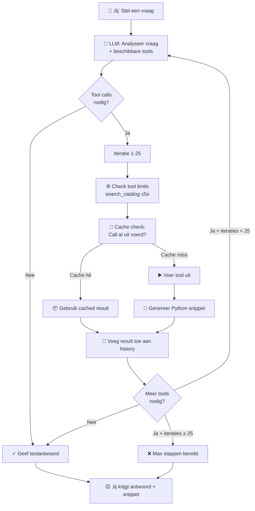
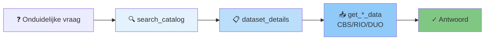
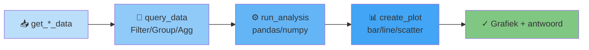
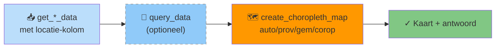
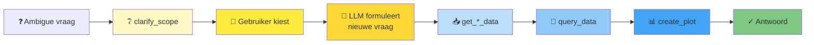
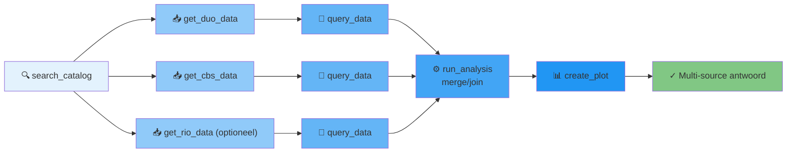

# Tools

De assistent beschikt over de volgende tools. Ze worden automatisch ingezet op basis van je vraag — je hoeft ze niet expliciet aan te roepen.

Bij elke tool-aanroep wordt een reproduceerbaar Python-snippet getoond in de chat, zodat je de analyse lokaal kunt herhalen.

## Hoe tool calling werkt

De assistent volgt een **agentic loop**:

1. **Je stelt een vraag** → Vraag wordt naar het LLM gestuurd met beschikbare tool-schema's
2. **LLM beslist** → Kiest welke tools nodig zijn met parameters
3. **Tools worden uitgevoerd** → Synchroon, in parallel wanneer mogelijk
4. **Resultaten teruggevoerd** → LLM ziet output en beslist of meer tools nodig zijn
5. **Loop** → Stappen 2-4 herhalen totdat LLM alleen tekst antwoordt (geen tool calls meer)

**Beperkingen per turn:**
- Maximaal 25 iteraties (stap 2-4, configureerbaar via `MAX_TOOL_ITERATIONS`)
- `search_catalog` max 5x per vraag
- Tool-resultaten begrensd op 12.000 karakters

**Caching:** Als dezelfde tool met identieke parameters tweemaal wordt aangeroepen, geeft het systeem het eerder gecachde resultaat terug (geen dubbele query).

### Flowchart

---

## Tool Calling Patterns

Aanbevolen tool-sequenties (chains) voor verschillende soorten vragen. Het LLM kiest idealiter deze volgorde:

### Pattern 1: Data Verkenning (Discovery)

**Gebruik:** Onbekende vraag, weten niet welke data beschikbaar is.

**Ideale volgorde:**
1. `search_catalog` — Zoek relevante datasets
2. `dataset_details` — Inspecteer beschikbare kolommen en filters
3. `get_*_data` — Haal de geselecteerde data op

**Voorbeeld:** "Hoeveel MBO-instellingen zijn er in Utrecht?"
- search_catalog → "MBO instellingen" → RIO-dataset gevonden
- dataset_details → RIO-dataset → organisatorischeEenheidcode, plaats, etc.
- get_rio_data → Filter op plaats='Utrecht' en soort=MBO

#### Flowchart

---

### Pattern 2: Analyse met Visualisatie

**Gebruik:** Data beschikbaar, nu analyseren en visualiseren.

**Ideale volgorde:**
1. `get_*_data` — Laad volledige dataset
2. `query_data` — Filter, groepeer, aggregeer indien nodig
3. `run_analysis` — Voer berekeningen, transformaties uit (pandas/numpy)
4. `create_plot` — Maak interactieve grafiek

**Voorbeeld:** "Toon MBO-inschrijvingen per jaar als line chart"
- get_duo_data → studentprognoses-mbo
- query_data → Group by Jaar, sum Aantal
- run_analysis → (optioneel: extra berekeningen)
- create_plot → line chart

#### Flowchart

---

### Pattern 3: Geografische Analyse

**Gebruik:** Geografische vraag, visualiseer op kaart van Nederland.

**Ideale volgorde:**
1. `get_*_data` — Laad data met locatie-kolom
2. `query_data` — (Optioneel) filter indien nodig
3. `create_choropleth_map` — Maak provincie/gemeente/COROP kaart

**Voorbeeld:** "MBO-inschrijvingen per provincie als kaart"
- get_rio_data → MBO-instellingen per provincie
- create_choropleth_map → niveau="provincie"

#### Flowchart

---

### Pattern 4: Scopeverduidelijking + Analyse

**Gebruik:** Vraag is ambigue, eerst verduidelijken dan analyseren.

Twee open slots herkent de app zelf, vóór het model de vraag ziet (`agent/scopevraag.py`, #348): een
telling bij een plaats die in meer dan één instellingsnaam uit het register zit ("Hoeveel studenten
heeft Utrecht?") krijgt een kaart met de instellingen uit het register en de woonplaats als opties; een
kort thema zonder maat ("arbeidsmarkt") een kaart met de catalogusrecords die `search_catalog`
bovenaan zet, mits elke term raakt. Dezelfde vraag geeft zo altijd dezelfde eerste stap; de opties zijn
altijd geldig. Noemt de vraag een instelling, of bepaalt het profiel haar, dan komt er geen kaart. Na de
keuze formuleert het model het antwoord; `clarify_scope` is dan weg (#75).

**Ideale volgorde:**
1. `clarify_scope` — Toon keuzes aan gebruiker
2. (Wacht op keuze) — Gebruiker selecteert optie
3. (LLM formuleert nieuwe vraag met context)
4. `get_*_data` → `query_data` → `create_plot` — Analyseer met gekozen scope

**Voorbeeld:** "Hoeveel studenten in MBO?"
- clarify_scope → "Bedoel je ingeschrevenen, afgestudeerden, of dropout?"
- Gebruiker kiest "ingeschrevenen"
- get_duo_data → query_data → create_plot

#### Flowchart

---

### Pattern 5: Complexe Analyse (Multi-Source)

**Gebruik:** Combineer data uit meerdere bronnen, voer geavanceerde analyses uit.

**Ideale volgorde:**
1. `search_catalog` — Vind relevante datasets
2. `get_cbs_data` + `get_duo_data` + `get_rio_data` — Laad meerdere datasets (parallel)
3. `query_data` — Filter en selecteer kolommen per dataset
4. `run_analysis` — Voer pandas join/merge uit op meerdere datasets
5. `create_plot` — Visualiseer gekombineerde analyse

**Voorbeeld:** "Vergelijk MBO-inschrijvingen (DUO) met bevolking (CBS) per regio"
- search_catalog → Vind beide datasets
- get_duo_data + get_cbs_data (parallel)
- run_analysis → Merge op regio
- create_plot → Duo-axis chart

#### Flowchart

---

## Keuzes die het LLM maakt

Bij elke vraag bepaalt het LLM automatisch:

| Beslissing | Criterium |
|-----------|-----------|
| **search_catalog nodig?** | Vraag noemt geen specifieke dataset |
| **dataset_details nodig?** | Onzeker over beschikbare filters/dimensies |
| **query_data nodig?** | Data moet gefilterd, gegroepeerd of geclusterd |
| **run_analysis nodig?** | Complexe berekeningen, transformaties, joins |
| **Visualisatie nodig?** | Vraag vraagt om grafiek/kaart, OF data is complex |
| **clarify_scope nodig?** | Vraag heeft meerdere geldige interpretaties |

Het LLM springt stappen over als ze niet nodig zijn. Dit heet **"lazy evaluation"** — efficiënter en sneller.

## get_maat

Vaste maat uit een vast recept (#188): het model kiest de maat en de afbakening, de code kiest dataset, bestand,
kolommen en codes (`tools/maten.py`). Elke fout uit de audits die in de keten zoeken → details → bestand → codes
zat (verkeerde instellingscode, T001228 als voltijd, het bestand zonder OPLEIDINGSVORM, personen of inschrijvingen
per sessie anders, verkeerd schooljaar) is zo een beslissing van code.

| Parameter | Type | Beschrijving |
|-----------|------|-------------|
| `maat` | string | `ingeschreven_personen_ho` (p01hoinges), `inschrijvingen_ho` (p03hoinschr), `eerstejaars_ho` (p02ho1ejrs), `deelnemers_ho_landelijk` (CBS 85423NED), `mbo_studenten_instelling` (mbo-studenten-per-instelling) |
| `instelling` | string | Officiële naam of alias; het register (`data/instellingen.py`) geeft code en sector. Onbekend is een fout, geen gok |
| `sector` | string | Alleen landelijk: `hbo` of `wo` |
| `vorm` | string | `alle` (standaard), `voltijd`, `deeltijd`, `duaal` (ho) of `bol`, `bbl` (mbo) |
| `schooljaren` | array | `2024/25` of `2024`; weglaten voor alle beschikbare |

Per maat ligt vast: het DUO-bestand (het opleidingsvorm-bestand per sector, #325), de telkolom, de codes van de
vorm (`VT`/`DT`/`DU`, bij CBS `A028666`…), de vaste CBS-totaalcodes (fase, geslacht) en de teldefinitie. De tool
laadt en selecteert met `get_duo_data`/`get_cbs_data` en `query_data`, dus scopegrens, sentinelmaskering, afronding
en KeyMeta gelden gewoon. Het resultaat: `data_key` met één rij per studiejaar, `teldefinitie`, `recept` (wat de
code koos), `periodekolom`/`waardekolom`, en `ontbrekende_schooljaren` als de bron een gevraagd jaar niet heeft.
Bij mbo is `AANTAL` de som van de leerwegkolommen van de vorm, als eigen key. Een key uit `get_maat` komt na een
herstart terug door het recept opnieuw te draaien (`tools/herlaad.py`); de snippet is het recept als script.

**Standaard:** "studenten" = personen (p01); inschrijvingen (p03) alleen op expliciete vraag, met vermelding.

---

## search_catalog

Doorzoekt de gecombineerde catalogus van CBS, RIO en DUO.

| Parameter | Type | Beschrijving |
|-----------|------|-------------|
| `query` | string | Zoekterm, bijv. `"mbo studenten prognose"` |
| `top_n` | integer | Maximaal aantal resultaten (standaard: 15) |
| `geo_niveau` | string | Filter op geografisch niveau (optioneel) |

**Gebruik:** Als startpunt bij onduidelijke vragen of om te verkennen welke datasets beschikbaar zijn.

**Let op:** Deze tool is beperkt tot **5 aanroepen per vraag** om oneindige zoeklussen te voorkomen.

Elke hit draagt een `status` (#356): `opvraagbaar` (een datatool laadt hem), `via_tool` (alleen met de genoemde eigen
tool, zoals `get_uwv_vacatures`), `alleen_documentatie` (de bron heeft alleen een PDF of changelog) of
`alleen_catalogus` (vindbaar en voor de package leesbaar, maar zonder chat-adapter). Zoekbaar, package-leesbaar en
chat-opvraagbaar zijn zo drie verschillende dingen; `_niet_opvraagbaar` in `tools/catalog.py` is de enige plek die
beslist, de package meldt alleen wat ze kan lezen. De interne bronfilter `source` betekent wat hij zegt: `cbs`,
`rio` (alleen RIO), `duo` (alleen DUO), `riodata` (alles uit de riodata-package) of `both`.

---

## dataset_details

Haalt metagegevens van een specifieke dataset op (kolommen, dimensies, beschrijving).

| Parameter | Type | Beschrijving |
|-----------|------|-------------|
| `dataset_id` | string | Dataset-ID, bijv. `"85423NED"` (CBS) of `"studentprognoses-mbo-v1"` (DUO); met of zonder bron-voorvoegsel (`cbs:`, `duo:`, `rio:`), hoofdletterongevoelig |

**Gebruik:** Verken beschikbare dimensies/filters voordat je data ophaalt.

Voor een CBS-tabel komen de velden uit het contract van de CBS-package (`tools/cbs_meta.py`, #383, #370):
`populatie` (bronpassages), `sectoren` (mbo/hbo/wo in het profiel), `teldefinitie`, `methodiek` (afronding,
additiviteit, definitiebreuken, publicatiestatus), `perioden` (frequentie, eerste en laatste periode, en per
periodecode de titel met de CBS-status zolang die niet definitief is) en `geografie` (niveaus, dekking). Wat het
contract niet vastlegt, staat er niet in. Het contract-ID `cbs:85423NED`, `cbs_85423ned` en `85423NED` wijzen in
`dataset_details`, `get_cbs_data` en `get_cbs_dimension` naar dezelfde tabel (`tools/catalog.py::cbs_bron_id`: zonder voorvoegsel, in de spelling van de catalogus).
Hetzelfde geldt voor DUO en RIO (#356): `duo:p01hoinges`, `DUO/P01HOINGES` en `rio:erkenningen` wijzen in `dataset_details`,
`get_duo_data`, `get_rio_data` en de scopegrens naar hetzelfde record (`tools/catalog.py::bron_id`); de evals en de packages
spellen `<bron>:<id>`. Het detailrecord draagt dezelfde `status` als een zoekhit.

---

## dataset_counts

Geeft het aantal datasets per bron (CBS, DUO, RIO) dat de chat kan opvragen, plus het aantal gearchiveerde CBS-tabellen. Geen parameters. Dezelfde telling voedt de startpagina.

**Gebruik:** bij een vraag naar hoeveel datasets er zijn. Een telling van zoekresultaten is geen catalogustotaal (#168).

De chat telt alleen RIO/DUO-records binnen het profiel mbo/hbo/wo (`tools/scopeprofiel.py`, #355). Een record valt erbinnen als `onderwijstype` alleen MBO, HBO, WO of HO noemt, of als het ID met een reden in `TOEGELATEN` staat. Al het andere valt erbuiten: po/so/vo, gemengde bestanden, records zonder besluit, en wat riodata als `buiten_scope` markeert (#375). Zoeken telt ze niet mee; `dataset_details`, `get_duo_data` en `get_rio_data` geven voor zo'n ID `opvraagbaar: false` en `buiten_scope: true` in plaats van data, ook als het ID rechtstreeks uit de vraag komt.

---

## get_cbs_data

Haalt rijen op uit een CBS-dataset via de OData API. Het model stuurt een gesloten
`selectie`; de server compileert daaruit de OData-parameters (#343, ADR-006). Een selectie
waarin een dimensie noch gepind noch bewust uitgesplitst is, wordt geweigerd vóór de
datacall, met de ontbrekende dimensie(s) erbij.

| Parameter | Type | Beschrijving |
|-----------|------|-------------|
| `dataset_id` | string | CBS dataset-ID, bijv. `"85423NED"` |
| `selectie` | object | `dimensies`: per dimensie een code uit `get_cbs_dimension`, een lijst codes of `"*"` (uitsplitsen); `periode`: lijst van schooljaren/periodecodes, `{"van", "tot"}` of `"*"`; `onderwerpen`: optioneel, kolomsleutels; `sector`: optioneel, `mbo`, `hbo` of `wo`, de sector waarvoor het model de tabel bevraagt |

Voorbeeld: `{"dimensies": {"Geslacht": "T001038", "Opleidingsfase": "*"}, "periode": ["2024/25"]}`.
Schooljaarspelling (`2024/25`) wordt in code vertaald naar de CBS-periodecode (`2024SJ00`).
Elke vergelijking in `$filter` gaat als `trim(Dimensie) eq 'code'`, omdat CBS de sleutels van een
dimensie opvult tot één breedte (`4000   ` naast `T001038`) en gestript toont (#531).
De rijlimiet is een beleidsregel van de server, geen modelparameter.

Na de selectiepoort vraagt `tools/cbs_preflight.py` het contract van de CBS-package (`validate_selection`,
live en gecachet) of de tabel de selectie kan leveren (#370): bestaat elke code in haar dimensie, komt de
periode in de tabel voor, en past de code bij de opgegeven `sector` (`hbo` met `Onderwijssoort=A025297`, wo,
is tegenstrijdig). Alleen `unsupported` houdt de datacall tegen; de weigering noemt per controle de reden en
wat wél in de tabel staat. `unknown` (bronuitval, een dimensie die het contract niet kent) laat door.

De parameter `filters` (ruwe OData, `{"$filter": …}`) bestaat nog voor bewaarde recepten
en het herladen/verversen van oudere gesprekken, maar zit niet meer in de modelinterface.

---

## get_cbs_dimension

Haalt de mogelijke waarden op van een dimensie in een CBS-dataset. Handig om te zien welke filterwaarden beschikbaar zijn.

| Parameter | Type | Beschrijving |
|-----------|------|-------------|
| `dataset_id` | string | CBS dataset-ID |
| `dimension_name` | string | Naam van de dimensie, bijv. `"Geslacht"` |

---

## get_rio_data

Haalt records op uit het RIO-register.

| Parameter | Type | Beschrijving |
|-----------|------|-------------|
| `resource` | string | Resource naam, bijv. `"onderwijslocaties"` |
| `filters` | object | Filterparameters, bijv. `{"organisatorischeEenheidcode": "25LH"}` |

Zie [Databronnen → RIO](databronnen.md) voor beschikbare resources.

---

## get_rio_instelling

Overzicht van één onderwijsinstelling uit RIO, in een vaste route in code (#412): zoek het
bevoegd gezag op naam (of via de instelling met die naam), volg de hiërarchische
instellingsrelaties naar de erkende instellingen en van daar naar de vestigingen, geldig op de
peildatum. Het resultaat noemt het bevoegd gezag, per instelling de vestigingscodes, en
`aantallen` (erkenningen = bestuur + instellingen + vestigingen). Lijsten zijn gesorteerd: dezelfde
registertoestand geeft hetzelfde resultaat. Past de naam op meer besturen, dan komen er
`kandidaten` in plaats van aantallen. Een bestuur zonder mbo- of ho-instelling (WEB/WHW) valt
buiten het profiel; po/vo/so-instellingen onder een mbo-bestuur tellen niet mee.

| Parameter | Type | Beschrijving |
|-----------|------|-------------|
| `naam` | string | Naam van de instelling of het bestuur, bijv. `"ROC Mondriaan"` |

---

## get_duo_data

Laadt een DUO open dataset. Retourneert kolomschema, voorbeeldwaarden en een `data_key` voor vervolgquery's.

| Parameter | Type | Beschrijving |
|-----------|------|-------------|
| `dataset_id` | string | CKAN package-naam, bijv. `"studentprognoses-mbo-v1"` |
| `resource` | integer \| string | Index of naam-substring van het bestand binnen de dataset (standaard: 0) |

!!! note
    De geladen data wordt gecached in de sessie. Roep `get_duo_data` eenmalig aan per dataset en gebruik daarna `query_data` voor gefilterde analyses.

---

## query_data

Filtert, groepeert en aggregeert rijen uit gecachede data. Werkt voor alle databronnen na het ophalen (CBS, RIO, DUO) en voor resultaten van `run_analysis`.

| Parameter | Type | Beschrijving |
|-----------|------|-------------|
| `data_key` | string | Sleutel uit een eerdere tool-aanroep, bijv. `duo:123:0`, `cbs:85423NED` |
| `filters` | object | Kolomfilters met operators: `{"Jaar": {"gte": "2020"}}`, of exact: `{"Leerweg": "Voltijd"}` |
| `columns` | array | Alleen deze kolommen teruggeven |
| `max_rows` | integer | Maximaal aantal rijen (standaard: 500) |
| `group_by` | array | Groeperen op deze kolommen |
| `aggregate` | object | Aggregatiefuncties per kolom, bijv. `{"Aantal": "sum"}` |

---

## dataset_profiel

Het profiel van een geladen tabel (#59, #61): per kolom het type, waar hij op lijkt (`identificatie`, `jaar`,
`schooljaar`, `geocode`, `categorie`, `getal`, `datum`, `tekst`), lege en unieke cellen, bereik en kwartielen
(meetkolommen) of de vaakste waarden, plus `dubbele_rijen_pct` en `kandidaat_sleutels`: de kleinste
kolomcombinaties (tot drie kolommen) die elke rij apart aanwijzen. `korrel` zegt het in woorden.

| Parameter | Type | Beschrijving |
|-----------|------|-------------|
| `data_key` | string | Key uit een laad- of filterstap |

Pure pandas (`tools/profiel.py`), één keer per key berekend en onthouden zolang dezelfde data onder die key
staat; op een afgekapte pagina (`volledig: false`) is het een profiel van de pagina, met waarschuwing.

**Gebruik:** vóór een som of telling over een tabel waarvan het model de korrel niet zeker weet. Een som over
een kolom buiten de korrel telt dubbel (totaalrijen naast onderdelen, meerdere resources in één bestand).

---

## relatie

Relatielaag, stap 1 (#63): wat hangt aan wat tussen CBS, DUO en RIO, uit bestaande kennis en zonder model
(`tools/relaties.py`). Sleutels die bronnen delen (connectoren): instellingscode (BRIN), instellingsnaam,
gemeente, gemeentenaam, provincie, schooljaar, erkende opleiding, opleidingseenheid en aangeboden opleiding,
elk met de kolomnamen waaronder hij voorkomt en een vaste vertaling van de waarden (`GM0344` ↔ `344`,
`PV26` ↔ `Utrecht`, `2021SJ00` ↔ `2021` ↔ `2021/2022`). CBS `RegioS` wordt aan de waarden herkend.

| Parameter | Type | Beschrijving |
|-----------|------|-------------|
| `data_key` | string | De tabel |
| `andere_key` | string | Optioneel: de tabel om mee te koppelen |

Met één key: per sleutelkolom `koppelt_aan` (register, gebiedsindeling, RIO), `basis` (`handmatig`),
`confidence` (1.0 voor codes met vaste vertaling, 0.8 voor namen) en `dekking` (hoeveel waarden het
instellingsregister, de arbeidsmarktregio-indeling of de provinciecodes kennen). Met twee keys ook
`koppelingen`: de kolomparen met dezelfde sleutel, `type` (one_to_one … many_to_many) en `overlap` van de
genormaliseerde waarden. De tool koppelt niets; de kandidaten staan in het log (`RELATIE kandidaten=…`,
zonder waarden) en de koppeling zelf is een stap in `query_data` of `run_analysis`.

---

## compute_kpi

Berekent één KPI-waarde deterministisch in code over data die al in de store staat, zodat het model zelf geen verschillen of percentages hoeft uit te rekenen. Het model neemt de teruggegeven `value` en `trend` letterlijk over.

| Parameter | Type | Beschrijving |
|-----------|------|-------------|
| `data_key` | string | Sleutel van een `query_data`-resultaat |
| `value_column` | string | Kolom met de numerieke waarden |
| `metric` | string | `last`, `first`, `sum`, `mean`, `min`, `max`, `delta` (laatste − eerste), `pct_change` (procentuele verandering eerste → laatste) of `index` (laatste waarde met eerste = 100), `max_drop` of `max_rise` (grootste daling of stijging tussen twee opeenvolgende rijen; het antwoord noemt in `tussen` welke twee) |
| `sort_column` | string | Optioneel: kolom om op te sorteren voor `last`/`first`/`delta`/`pct_change`/`index`/`max_drop`/`max_rise`, bijv. `STUDIEJAAR`. Zonder deze kolom telt de rijvolgorde. |
| `label` | string | Label van de KPI, bijv. "Voltijd 2025/26" |

---

## run_analysis

Voert pandas/numpy-code uit op eerder opgehaalde data, in een apart, afgeschermd proces.

| Parameter | Type | Beschrijving |
|-----------|------|-------------|
| `code` | string | Python-code (pandas, numpy, plotly express beschikbaar) |
| `data_key` | string | Optionele data_key — het bijbehorende DataFrame is beschikbaar als `df` |

Een AST-controle weigert vooraf onder meer imports, namen met `__` en `exec`, `eval` en `open`. Het script draait daarna in een eigen proces zonder geheimen, netwerk of schrijfrechten, met limieten op CPU-tijd en geheugen en een time-out van 10 seconden. Beschikbare namen: `pd`, `np`, `math`, `px`, `go`, `df` en `store_get`. De afscherming is geen beveiligingsgrens: het model kan willekeurige Python laten uitvoeren binnen de sandbox. Zie [Kwaliteit en veiligheid](kwaliteit-en-veiligheid.md#analyse-sandbox), #62 en #443.

---

## create_plot

Maakt een interactieve Plotly-grafiek.

| Parameter | Type | Beschrijving |
|-----------|------|-------------|
| `chart_type` | string | `"bar"`, `"line"`, `"scatter"`, `"pie"` of `"histogram"` |
| `x` | string | Veldnaam voor de x-as (of labels bij pie) |
| `y` | string | Veldnaam voor de y-as (of waarden bij pie) |
| `title` | string | Titel van de grafiek |
| `data_key` | string | Data_key van eerder opgehaalde data (optioneel, alternatief voor `data`) |
| `data` | array | Lijst van datarijen als objecten (optioneel, alternatief voor `data_key`) |
| `color_by` | string | Veldnaam voor groepering (optioneel) |

De grafiek wordt direct in de chat weergegeven.

---

## create_choropleth_map

Maakt een choropleth-kaart van Nederland op provincie-, gemeente- of COROP-niveau.

| Parameter | Type | Beschrijving |
|-----------|------|-------------|
| `location_col` | string | Kolomnaam met locatienamen |
| `value_col` | string | Kolomnaam met waarden |
| `title` | string | Titel van de kaart |
| `data_key` | string | Data_key van eerder opgehaalde data (optioneel) |
| `data` | array | Lijst van datarijen als objecten (optioneel) |
| `level` | string | `"auto"`, `"provincie"`, `"gemeente"` of `"corop"` (standaard: auto) |

---

## clarify_scope

Stelt een verduidelijkingsvraag aan de gebruiker wanneer de oorspronkelijke vraag meerdere interpretaties heeft.

| Parameter | Type | Beschrijving |
|-----------|------|-------------|
| `vraag` | string | De verduidelijkingsvraag |
| `opties` | array | 2-3 keuzes met `label`, `beschrijving` en `aanbevolen` (boolean) |

**Gebruik:** Wanneer ambiguïteit voorkomen kan worden. Onderbreekt de normal flow: je selecteert een optie, dan gaat het LLM een nieuwe vraag formuleren met jouw keuze.

Deze tool wordt afgehandeld door de UI — de gebruiker ziet een keuzemenu en kan een optie selecteren.

---

## suggest_follow_ups

Zet onder een antwoord met data tot drie klikbare vervolgvragen. Het model roept deze tool aan als laatste stap,
in hetzelfde bericht als zijn antwoord en zonder andere tools ernaast; de tool heeft geen parameters.

Het model beslist alleen dát er vervolgvragen komen. Welke, beslist de app (`agent/vervolgvragen.py`): voorbeeldvragen
uit de catalogus van de datasets die de beurt laadde, om en om per dataset. Een voorbeeldvraag komt alleen in
aanmerking als de chat haar kan beantwoorden:

- de dataset valt binnen het profiel (mbo, hbo, wo) en de chat kan hem ophalen met `get_*_data`;
- de vraag staat niet in de eerste persoon ("mijn regio", "onze instelling");
- ze noemt geen ruwe veldnaam, codewaarde of technische term (`AANGEBODENBOOPLEIDING`, `eindeAanmeldperiode`,
  code `C0001`, "sub-resource") en geen dataset bij zijn ID (`aangeboden-opleidingen`, `85423NED`);
- ze staat op zichzelf: een sjabloonvraag als "Hoe verhoudt dit zich tot andere jaren?" of "… in de data?" valt af;
- ze gaat niet over po, so of vo ("BO-opleidingen", vmbo, havo);
- ze vraagt geen aantal uit een RIO-register: `get_rio_data` levert één pagina en geen totaal;
- `search_catalog` vindt met de vraag haar eigen dataset terug.

De vraag die de gebruiker net stelde en wat het gesprek al eerder aanbood, komen niet terug. Een klik zet de vraag in
het invoerveld; de gebruiker past haar aan of verstuurt haar zelf.

Geen vervolgvragen na een verduidelijkingsvraag, een weigering, een ingehouden, leeg of afgebroken antwoord, of een
beurt zonder geladen dataset (zoals alleen UWV of ROA). De aanroep telt niet als datastap: een antwoord met een getal
zonder opgehaalde data blijft de vaste weigering.

Zonder antwoordtekst, of samen met andere tools, sluit de aanroep de beurt niet af: het model krijgt terug dat het
eerst moet antwoorden of de tool alleen moet aanroepen. Na twee van zulke aanroepen geldt de toollimiet. Rapport en
dashboard kennen de tool niet.
